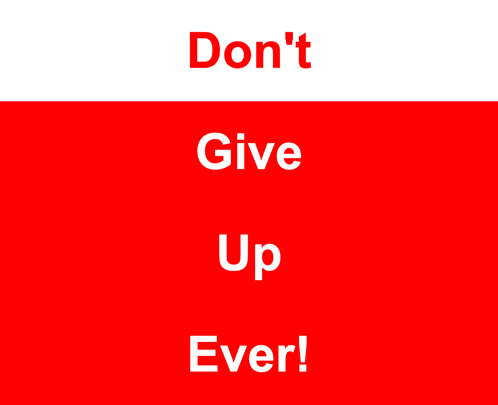
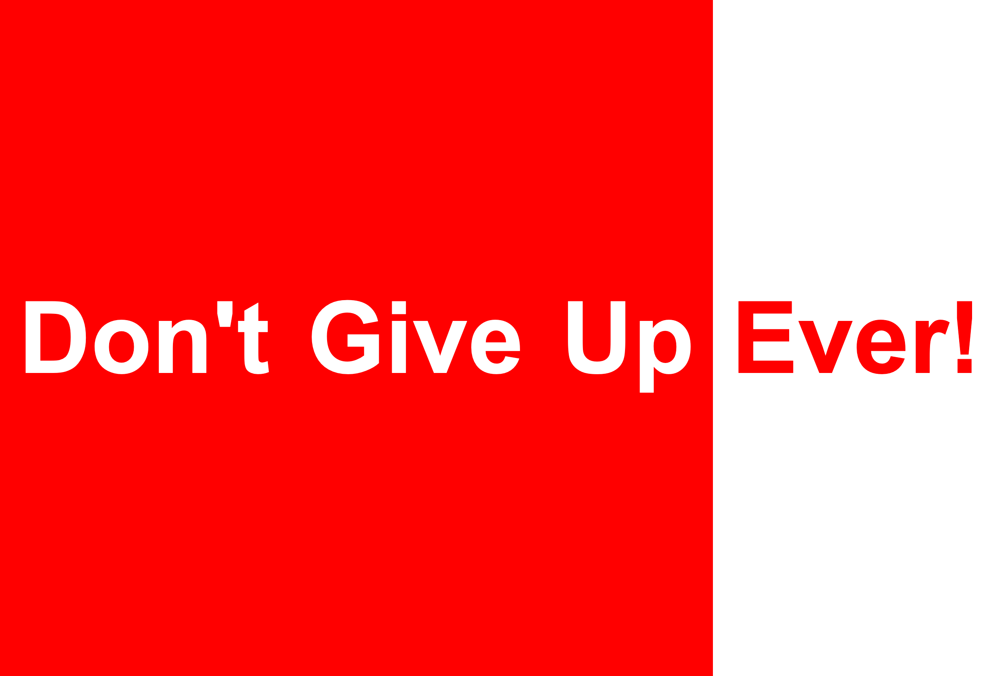

# dont-give-up

Maak wat je ziet in de [video](./opgave.mp4) na. Afbeeldingen van de twee layouts zijn voorzien om gemakkelijker te controleren en `index.html` is gegeven.

* kleuren: red, white
* gebruik lettertype Arial (met een fallback naar een willekeurig schreefloos font), een `font-size` van `10rem` en een `font-weight` van `900`
* bouw de layout met flexbox (gap van `2rem`)
* media-query op 1000px, waarbij flex-richting verandert
* geef de container een `min-height` van `100vh` zodat de layout het volledige scherm vult
* bij hover wisselt een item van kleur: witte achtergrond met rode tekst

Probeer na afloop de lists (`<ul>` en `<li>`) eens om te zetten naar `
`. Wat kun je dan allemaal weglaten?

## Verwacht resultaat

Onder 1000px staan de items onder elkaar:

Vanaf 1000px staan ze naast elkaar:

