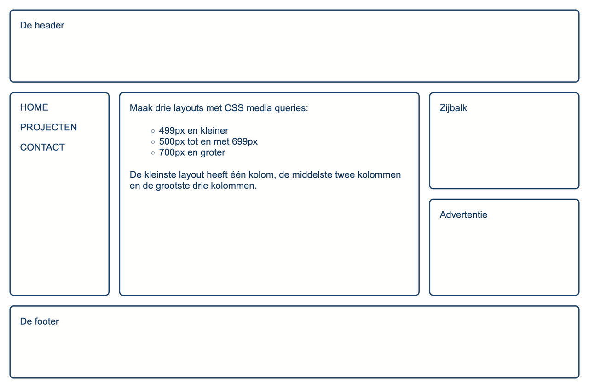
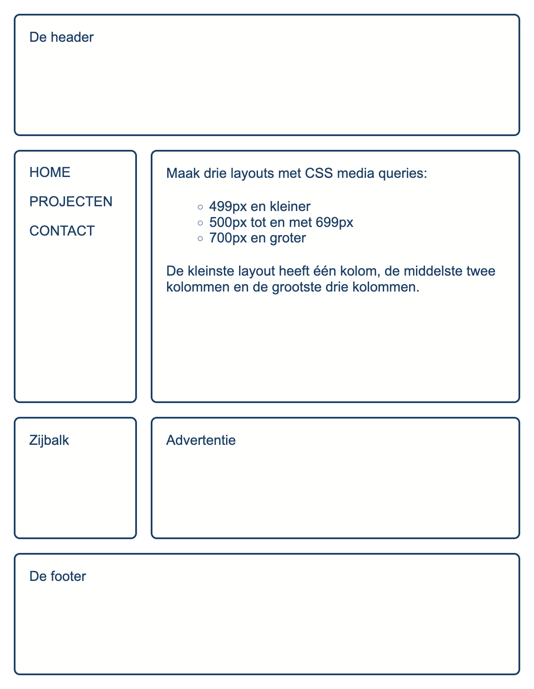
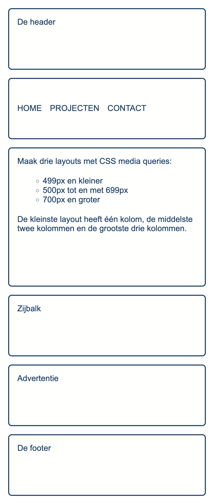

# page-layout

Maak de pagina na die je in de opgavescreenshots ziet. `index.html` is gegeven: je schrijft enkel CSS.

De pagina bestaat uit zes blokken (`header`, `nav`, `main`, `aside`, `.ad` en `footer`) die telkens dezelfde kader krijgen. Bouw de layout met **CSS Grid** en `grid-template-areas`, en verander met media-queries enkel de kolommen en de plaatsing van de blokken.

**Opbouw**

* werk mobile first: schrijf eerst de layout van één kolom en voeg daarna per breakpoint een media-query toe.
* gebruik lettertype Arial (met een fallback naar een willekeurig schreefloos font).
* bewaar de tekstkleur `#094067` in een custom property en gebruik ze voor de tekst en de randen.
* de `body` is het grid: `1rem` padding rondom, `1rem` gap tussen de blokken en een `min-height` van `100vh` zodat de layout het volledige scherm vult.
* elk blok met de klasse `container` krijgt `1rem` padding, een rand van `2px solid` in de hoofdkleur, een `border-radius` van `7px` en achtergrondkleur `#fffffe`.
* de paragrafen in `main` hebben `20px` ruimte boven en onder, behalve de eerste paragraaf: die sluit bovenaan aan.
* de lijst in `main` gebruikt open bolletjes (`circle`) en springt `50px` in.

**Navigatie**

* de links staan in hoofdletters en hebben geen onderlijning.
* bij hover verschijnt er een onderlijning van `2px` in de hoofdkleur, met een zachte overgang van `250ms`.
* onder 500px staan de links naast elkaar, vanaf 500px onder elkaar. Gebruik flexbox, met `1rem` tussen de links.

**Breakpoints**

| schermbreedte | kolommen | plaatsing |
| --- | --- | --- |
| tot 499px | 1 | alle blokken onder elkaar, in volgorde van de HTML |
| 500px tot 699px | 2 (`1fr 3fr`) | header over de volle breedte, dan nav naast main, dan aside naast de advertentie, dan de footer over de volle breedte |
| vanaf 700px | 3 (`2fr 6fr 3fr`) | header over de volle breedte, dan nav en main naast elkaar met aside en advertentie onder elkaar in de derde kolom, dan de footer over de volle breedte |

## Verwacht resultaat

Grote schermen (vanaf 700px):

Middelgrote schermen (500px tot en met 699px):

Kleine schermen (tot en met 499px):

