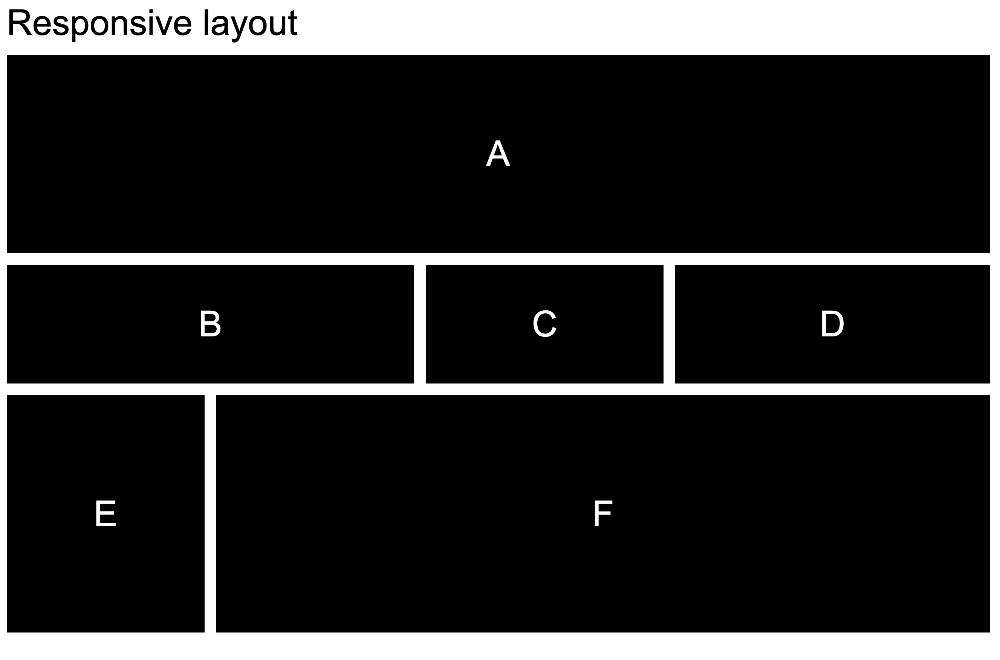
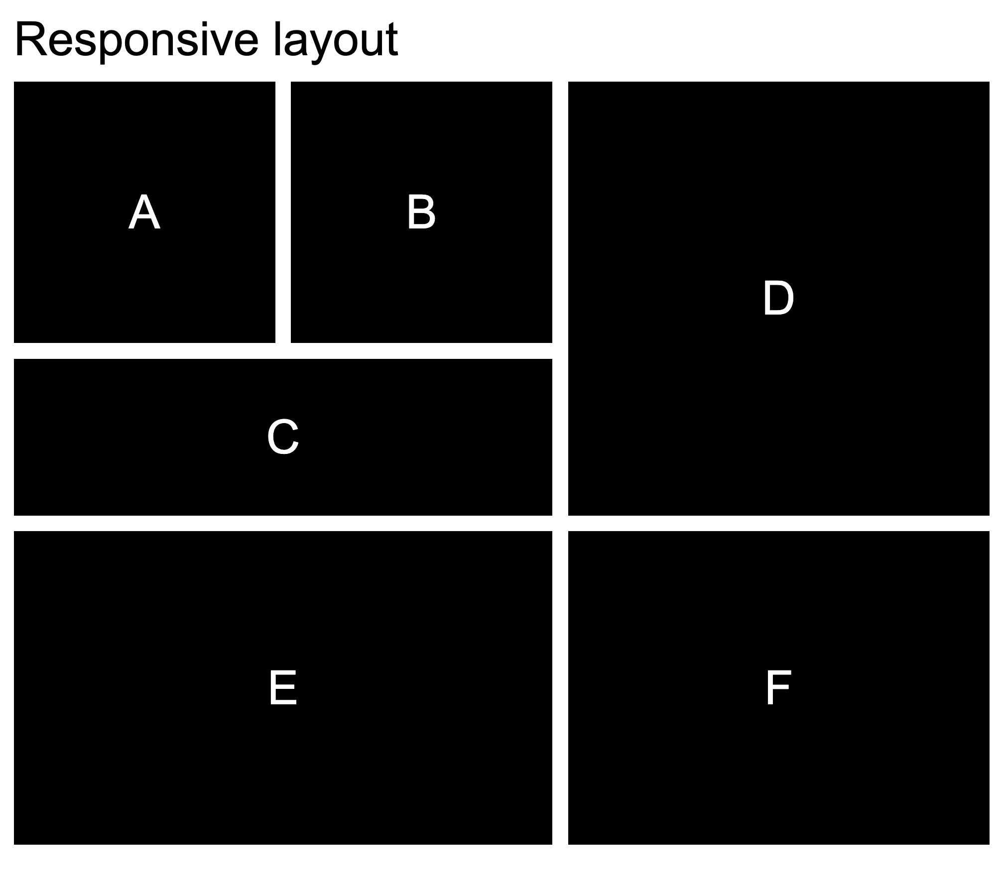
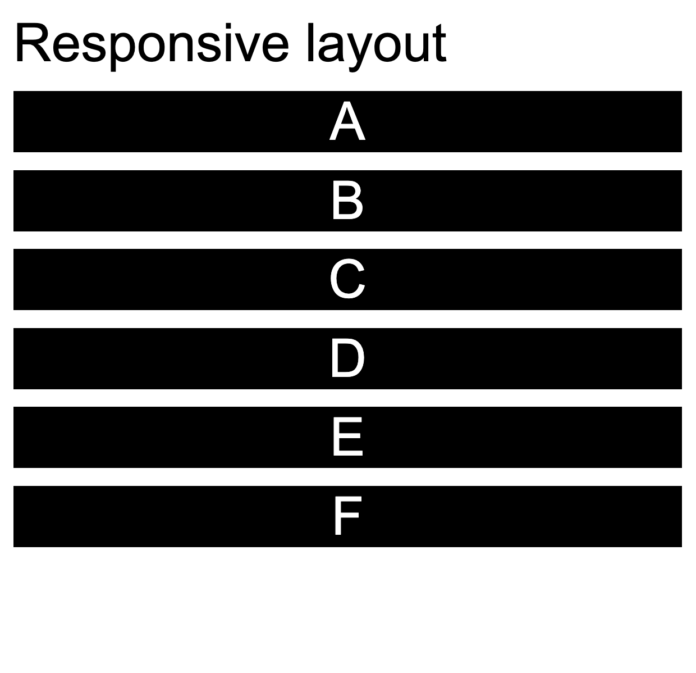

# responsive-grid

> Tip: deze oefening is gebaseerd op een examenvraag.

Je krijgt een HTML-bestand met een `<section class="part">`-element met daarin zes `
`-elementen, en een `style.css` waarin de opmaak van de boxen en de `grid-area`-namen al voor je klaarstaan. Het is jouw taak om daarmee een responsive layout te bouwen.

## Break-points

In deze oefening gebruiken we 3 break-points:

* **Small screens**: smaller dan 500px.
* **Medium screens**: vanaf 500px tot en met 599px.
* **Large screens**: vanaf 600px.

## Layout algoritmes

Bij small screens gebruik je flexbox voor de layout. Bij medium en large screens gebruik je een CSS grid.

### Grid configuratie

De parent heeft zowel bij medium als bij large screens **4 kolommen** en **3 rijen**:

* De eerste en tweede kolom zijn elk 150px breed.
* De derde kolom is 180px breed.
* De vierde kolom neemt de rest van de ruimte in (1fr).
* De eerste rij is 150px hoog.
* De tweede rij is 90px hoog.
* De derde rij is 180px hoog.

### Grid-children

De gap tussen de items is `1rem`, zowel horizontaal als verticaal. Zet de children afhankelijk van de schermbreedte in de volgende configuratie:

#### Medium screens

* De eerste rij bevat een deel "A", een deel "B" en twee delen "D".
* De tweede rij bevat twee delen "C" en twee delen "D".
* De derde rij bevat twee delen "E" en twee delen "F".

#### Large screens

* De eerste rij bevat vier delen "A".
* De tweede rij bevat twee delen "B", een deel "C" en een deel "D".
* De derde rij bevat één deel "E" en drie delen "F".

#### Small screens

Bij small screens is het geen grid maar een flexbox. Zorg dat alle children onder elkaar komen, met `1rem` tussen de flex-items.

## Requirements

* Ga **mobile first** te werk.
* Gebruik bij medium en large screens de gegeven `grid-area`-namen.
* Zorg dat je geen code dupliceert binnen de media-queries: pas enkel aan wat je nodig hebt.

## Verwacht resultaat

Large screens, vanaf 600px:

Medium screens, van 500px tot en met 599px:

Small screens, onder 500px:

