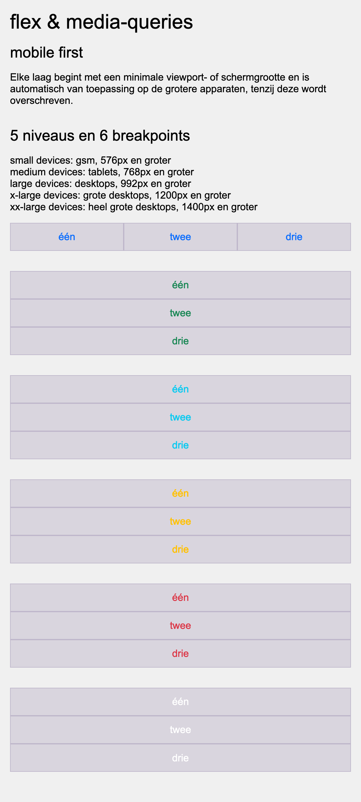
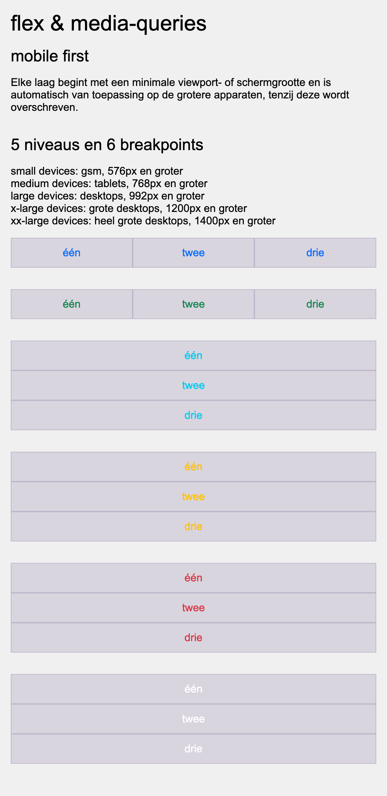
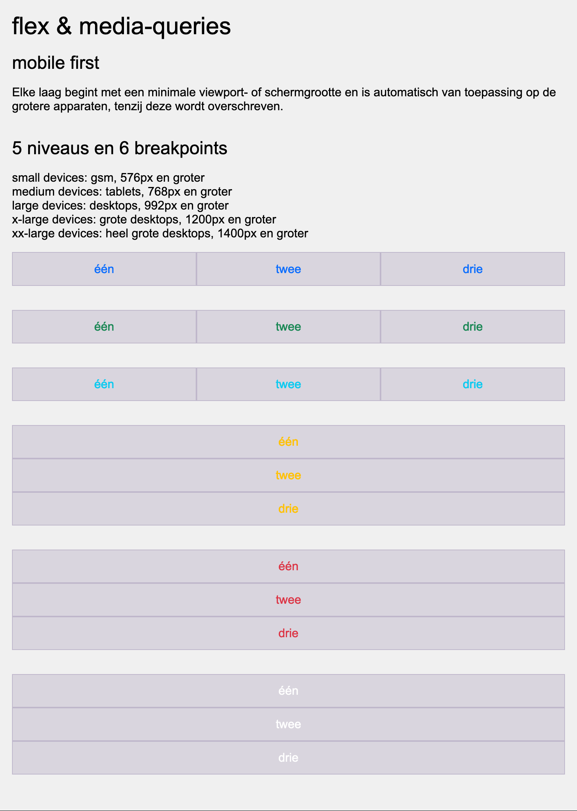
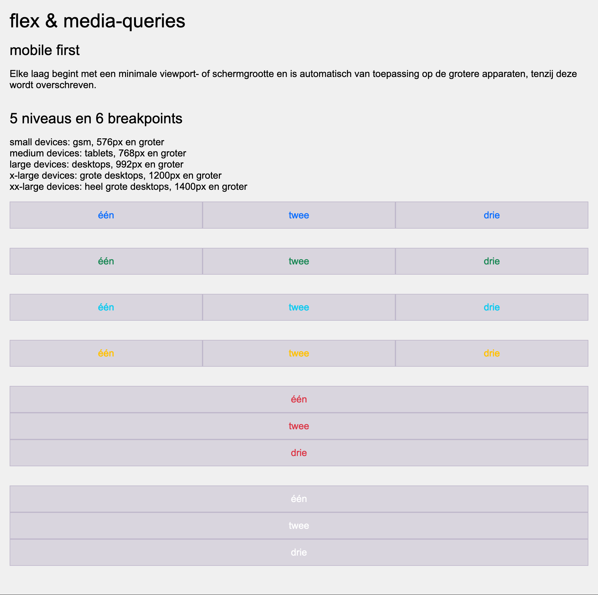
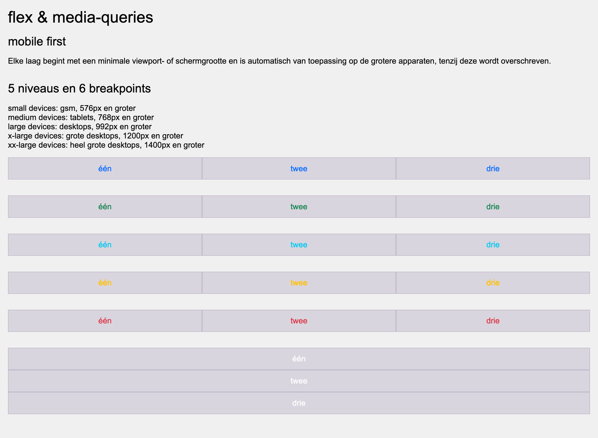
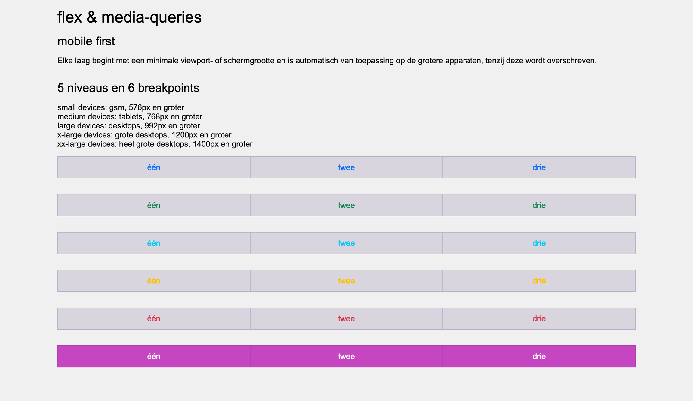

# responsive-lists

Maak de pagina na die je in de opgavescreenshots ziet. `index.html` is gegeven: je schrijft enkel CSS.

Op de pagina staan zes lijsten. Elke lijst zet haar items **onder elkaar** (kolom) tot haar eigen breakpoint en **naast elkaar** (rij) vanaf dat breakpoint. Zo zie je bij het versmallen van je browservenster de lijsten één voor één terugklappen naar een kolom.

**Opbouw**

* werk mobile first: schrijf eerst de kolomversie en voeg daarna per breakpoint een `min-width` media-query toe.
* bouw elke lijst met flexbox, zonder bolletjes.
* geef de pagina lettertype Arial (met een fallback naar een willekeurig schreefloos font) en achtergrondkleur `#f0f0f0`.
* de inhoud zit in een container van maximaal `1200px` breed, gecentreerd op de pagina met flexbox, met `1rem` padding rondom.
* elk lijstitem vult de volledige breedte, heeft gecentreerde tekst, `0.75rem` padding boven en onder, achtergrondkleur `rgba(86, 61, 124, 0.15)` en een rand van `1px solid rgba(86, 61, 124, 0.2)`.
* zet onder elke lijst `2rem` ruimte.

**Breakpoints**

| lijst | staat in rij vanaf | tekstkleur |
| --- | --- | --- |
| lijst-1 | altijd (ook onder 576px) | `#0d6efd` (blauw) |
| lijst-2 | 576px, small devices (gsm) | `#198754` (groen) |
| lijst-3 | 768px, medium devices (tablets) | `#0dcaf0` (cyaan) |
| lijst-4 | 992px, large devices (desktops) | `#ffc107` (geel) |
| lijst-5 | 1200px, x-large devices (grote desktops) | `#dc3545` (rood) |
| lijst-6 | 1400px, xx-large devices (heel grote desktops) | `#ffffff` (wit) |

Vanaf 1400px krijgt lijst-6 bovendien de achtergrondkleur `#cf04beb4` (paars), zodat de witte tekst leesbaar wordt.

## Verwacht resultaat

Standaard, tot en met 575px (enkel lijst-1 staat in rij):

Small devices, vanaf 576px (lijst-2 volgt):

Medium devices, vanaf 768px (lijst-3 volgt):

Large devices, vanaf 992px (lijst-4 volgt):

X-large devices, vanaf 1200px (lijst-5 volgt):

XX-large devices, vanaf 1400px (lijst-6 volgt en kleurt paars):

